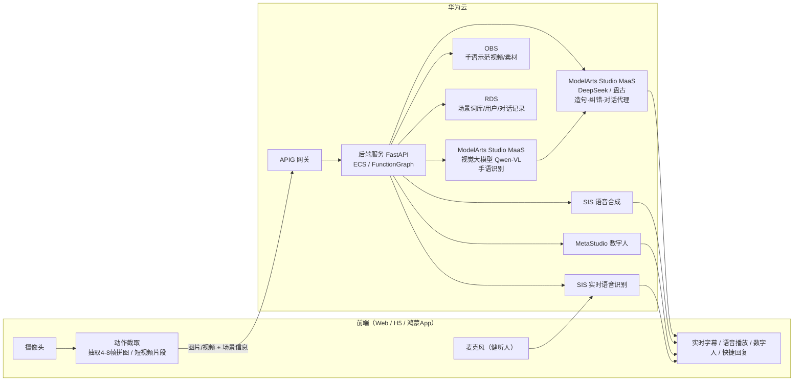
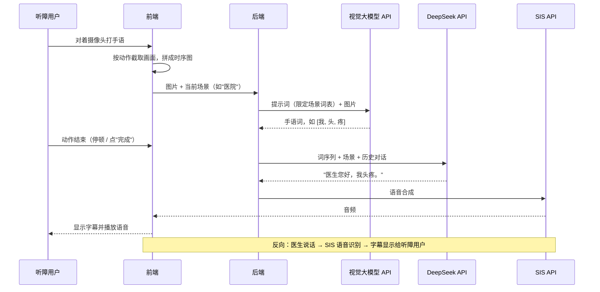
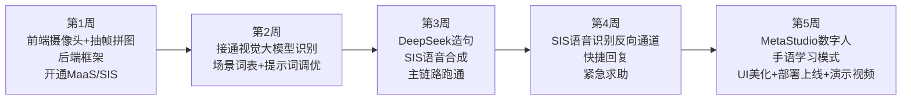

# AI 手语实时翻译平台 —— 设计思路与技术路线

> 赛道：华为 ICT 大赛 · 创新赛道（基于华为云产品打造 AI 创新应用）
> 项目暂定名：**手语通 SignBridge**
> 定位：**不训练模型**，通过调用华为云大模型和云服务 API，搭建一个"摄像头实时捕获手语 → 翻译成文字和语音"的双向无障碍沟通平台。

---

## 一、项目背景与痛点

- 我国有约 2780 万听力残疾人，手语翻译员严重不足。听障人士在医院、银行、政务大厅、出行等场景中沟通困难。
- 现有方案要么依赖人工翻译（成本高、需要预约），要么只能做单向的"文字转手语"。缺少**低门槛、实时、双向**的沟通工具。
- 大模型的多模态理解能力为"零训练"实现手语理解提供了可能。只需要一个**摄像头加一个浏览器**就能使用。

---

## 二、核心思路

**不自己训练模型，创新放在应用层：**

> 摄像头采集 → 视觉大模型**看懂**手语 → 文本大模型**整理**成通顺中文 → 语音或数字人**说出来**；
> 反过来，健听人说话 → 语音识别成字幕 → 听障人士看得懂。

全部能力通过华为云 API 调用获得，开发工作集中在：**前端交互、提示词工程、接口编排、场景化产品设计**。

---

## 三、系统架构



### 一次完整翻译的调用时序



---

## 四、使用的华为云产品

| 华为云产品 | 在项目中的作用 |
|---|---|
| **ModelArts Studio（MaaS）· 视觉大模型（Qwen-VL 系列）** | 理解摄像头画面中的手语动作，输出手语词或句子 |
| **ModelArts Studio（MaaS）· DeepSeek / 盘古大模型** | 把手语词序列整理成通顺中文；结合上下文纠错；生成快捷回复；场景对话代理 |
| **SIS 语音交互服务** | 语音合成（把翻译结果读出来）；实时语音识别（健听人说话转字幕） |
| **MetaStudio 数字人** | 数字人形象播报回复内容，提升亲和力 |
| **OBS 对象存储** | 存放手语示范视频、图片素材、前端静态资源 |
| **RDS 云数据库** | 场景词库、手语词典、用户信息、对话记录 |
| **ECS / FunctionGraph** | 部署后端服务；无状态的接口转发可以用函数工作流 |
| **APIG API 网关** | 统一接口入口、鉴权、限流 |
| **CDN（可选）** | 加速示范视频和前端页面 |

> MaaS 接口兼容 OpenAI 格式（`/v1/chat/completions`），用 API Key 鉴权。具体模型名和开通区域以控制台"预置服务"列表为准。

---

## 五、功能设计

### 1. 手语 → 文字 / 语音（核心）
- 打开网页，授权摄像头，选择场景（医院 / 银行 / 政务 / 出行 / 日常）。
- 打手语，系统实时显示识别出的词（灰色），一句话结束后显示整理好的句子（黑色）并自动播放语音。
- 识别结果给出 1–2 个候选句，用户点一下确认，避免误译。

### 2. 语音 → 字幕（反向沟通）
- 健听人对着设备说话，SIS 实时识别成大字幕，显示给听障用户。
- 可选：MetaStudio 数字人同步播报。

### 3. AI 对话代理（快捷回复）
- 根据对方说的话，DeepSeek 自动为听障用户生成 3 个快捷回复按钮。
  例如医生问"哪里不舒服？" → 生成【头疼】【发烧】【肚子疼】，点一下即可用语音说出。

### 4. 场景化模式
- 每个场景预置 50–100 个常用词和常见问答，提示词按场景切换，**提高识别准确率**。
- 例如医院模式：挂号、头疼、发烧、过敏、药、多少钱、在哪里……

### 5. 紧急求助
- 识别到"救命""难受""报警"等手语，或者点击求助按钮，自动生成求助文字并大声播报。

### 6. 手语学习（加分项）
- 展示标准手语示范视频，用户跟着打。视觉大模型点评动作是否到位，帮助健听人学习手语。

### 7. 对话记录
- 保存每次沟通的文字记录，便于回看（如医嘱）。

---

## 六、关键技术点：提示词工程

通用视觉大模型理解手语的能力有限，**靠提示词设计提升准确率**是本项目的核心技术工作。

### 1. 提高识别准确率的四个策略
| 策略 | 说明 |
|---|---|
| **限定词表** | 提示词中只给当前场景的常用词，让模型从中选，而不是自由识别 |
| **时序拼图** | 把一个动作的 4–8 帧按顺序拼成一张网格图，并标注帧序号，让模型理解动作过程 |
| **动作描述辅助** | 词表中附带每个词的标准动作文字描述（参考《国家通用手语词典》） |
| **人工确认兜底** | 输出 Top-2 候选，由用户点选，同时把结果作为上下文帮助后续理解 |

### 2. 视觉识别提示词（示例）
```text
你是中国手语翻译专家。
图片是一个人打手语的连续画面，按从左到右、从上到下的时间顺序排列，共6帧。
当前场景：医院就诊。
请从以下词表中选择最符合该动作的词（可以是多个词组成的序列）：
[你好, 谢谢, 我, 你, 医生, 头, 疼, 发烧, 咳嗽, 肚子, 药, 挂号, 多少钱, 在哪里, ...]
词表参考动作：
- 疼：……
- 发烧：……
只输出 JSON：{"words": ["..."], "confidence": 0-1, "alternatives": [["..."]]}
如果无法判断，输出 {"words": [], "confidence": 0}。
```

### 3. 造句提示词（示例）
```text
你是听障人士的沟通助手。手语语序与汉语不同，请把手语词序列整理成通顺、礼貌的中文口语。
规则：只能使用给定词语的含义，可补充必要的虚词，不得添加原文没有的信息。
场景：医院就诊
对话历史：医生："你哪里不舒服？"
手语词序列：[我, 头, 疼, 两天]
输出 JSON：{"sentence": "...", "alternative": "..."}
```

### 4. 快捷回复提示词（示例）
```text
对方（健听人）说："{asr_text}"。场景：{scene}。
请为听障用户生成3个简短、可能的回复，每个不超过10个字，输出 JSON 数组。
```

---

## 七、技术栈

| 层 | 技术 |
|---|---|
| 前端 | Vue3 + Vite + Element Plus；`getUserMedia` 调用摄像头；Canvas 抽帧拼图；WebSocket / HTTP |
| 后端 | Python 3.10 + FastAPI；`openai` SDK（指向 MaaS 地址）；`huaweicloudsdksis`（SIS）；MetaStudio REST API |
| 数据 | 华为云 RDS（MySQL）+ OBS |
| 部署 | Docker + 华为云 ECS；前端静态资源放 OBS 加 CDN |
| 移动端（可选） | 鸿蒙 ArkTS App，复用后端接口 |

### 目录结构
```
signbridge/
├── frontend/                 # Vue3 前端
│   ├── src/views/
│   │   ├── Translate.vue     # 手语翻译主页面（摄像头 + 字幕 + 语音）
│   │   ├── Listen.vue        # 语音转字幕页面
│   │   └── Learn.vue         # 手语学习页面
│   └── src/utils/capture.js  # 摄像头抽帧、拼图
├── backend/
│   ├── main.py               # FastAPI 入口
│   ├── services/
│   │   ├── maas_vision.py    # 视觉大模型调用
│   │   ├── maas_llm.py       # DeepSeek / 盘古调用
│   │   ├── sis.py            # 语音合成 / 识别
│   │   └── metastudio.py     # 数字人
│   ├── prompts/              # 提示词模板
│   └── data/scenes.json      # 场景词表
├── deploy/                   # Dockerfile、部署脚本
└── README.md
```

### 后端核心接口
| 接口 | 说明 |
|---|---|
| `POST /api/recognize` | 上传拼图和场景，返回手语词 |
| `POST /api/compose` | 上传词序列和上下文，返回通顺句子 |
| `POST /api/tts` | 文本转语音，返回音频 |
| `WS /api/asr` | 实时语音识别，推送字幕 |
| `POST /api/quick-reply` | 根据对方的话生成快捷回复 |
| `GET /api/scenes` | 获取场景及词表 |

### 调用示例（MaaS 视觉大模型）
```python
from openai import OpenAI

client = OpenAI(
    base_url="https://api.modelarts-maas.com/v1",  # 以控制台为准
    api_key="YOUR_MAAS_API_KEY",
)

def recognize(image_b64: str, scene: str, vocab: list[str]) -> str:
    prompt = build_vision_prompt(scene, vocab)  # 见第六节
    resp = client.chat.completions.create(
        model="qwen2.5-vl-72b",  # 以控制台"预置服务"中的 model 参数为准
        messages=[{
            "role": "user",
            "content": [
                {"type": "text", "text": prompt},
                {"type": "image_url",
                 "image_url": {"url": f"data:image/jpeg;base64,{image_b64}"}},
            ],
        }],
        temperature=0.1,
    )
    return resp.choices[0].message.content
```

---

## 八、开发计划（约 5 周）



| 阶段 | 交付物 |
|---|---|
| 第 1 周 | 能打开摄像头、抽帧拼图并上传；后端能调通 MaaS 和 SIS |
| 第 2 周 | 医院场景 30 个词可识别；提示词迭代并记录准确率 |
| 第 3 周 | 手语 → 句子 → 语音的完整链路可演示 |
| 第 4 周 | 双向沟通、快捷回复、紧急求助 |
| 第 5 周 | 数字人、学习模式、公网部署、比赛材料 |

---

## 九、创新点总结

1. **零训练的多模态手语理解**：基于华为云视觉大模型加提示词工程（场景限定词表、时序拼图、动作描述），不用采集数据、不用训练就能理解手语。
2. **"视觉大模型看 + 文本大模型想"两级协同**：视觉模型负责识别手语词，文本大模型负责调整语序、补全语义、上下文纠错，解决手语语序与汉语不一致的问题。
3. **双向无障碍沟通闭环**：手语 → 文字 / 语音，语音 → 字幕 / 数字人，真正做到"能说也能听"。
4. **AI 对话代理**：自动生成快捷回复，大幅降低听障用户的表达成本。
5. **场景化设计**：针对医院、银行、政务等高频场景定制，贴近真实需求，易于落地推广。
6. **低门槛**：只需浏览器和摄像头，无需专用硬件；全链路基于华为云，弹性可扩展。

---

## 十、风险与应对

| 风险 | 应对 |
|---|---|
| 视觉大模型识别手语不够准 | 场景限定词表、时序拼图、动作描述、Top-2 候选让用户确认；演示时固定场景 |
| 接口延迟影响实时体验 | 一个动作调用一次而不是每帧都调；造句只在句末调用；流式返回 |
| 大模型造句时编造内容 | 提示词限制只用给定词；输出备选句让用户确认 |
| 调用费用 | 只在动作结束时调用；图片压缩到 720p 以下；缓存常用结果 |
| 模型型号和区域变化 | 模型名写成配置项，可随时切换 MaaS 上的其他模型 |
| 隐私问题 | 画面只用于实时识别，默认不存储；对话记录需用户授权才保存 |

---

## 十一、参考资料

- 华为云 ModelArts Studio（MaaS）：模型推理 → 预置服务，OpenAI 兼容接口
- 华为云 SIS 语音交互服务：Python SDK `huaweicloudsdksis`
- 华为云 MetaStudio：数字人智能交互 API
- 《国家通用手语词典》/ 国家通用手语数字推广平台：手语词表和动作描述
- GitHub `bdekraker/WebcamGPT-Vision`：浏览器摄像头 → 视觉大模型 API 的前后端样板（可参考交互流程）
- GitHub `tobp03/live-asl-translation`：手语识别结果交给大模型润色的应用形态参考
