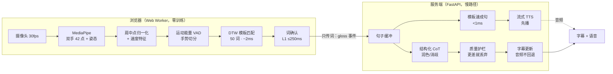

# gloss2speech · 手语通 SignBridge

> **实时中国手语翻译：摄像头 → 字幕 → 语音。** 端侧 VAD + 零训练 DTW 识别手语词，双平面智能体（快脑实时 / 慢脑润色），**词级延迟 218ms（P95）**。

[](https://www.python.org/)
[](https://fastapi.tiangolo.com/)
[](https://ai.google.dev/edge/mediapipe)
[](reports/latency_budget.md)
[](LICENSE)

> **English summary** — A real-time Chinese Sign Language translation demo: on-device hand/pose landmarks, motion-energy VAD, zero-training DTW template matching, then a dual-path agent (deterministic fast path for subtitles/TTS, LLM slow path for wording and disambiguation). Word-level latency 218ms P95; no video leaves the browser.

---

## 目录

- [项目状态](#项目状态)
- [核心特性](#核心特性)
- [为什么是 0.5s](#为什么是-05s)
- [系统架构](#系统架构)
- [快速开始](#快速开始)
- [使用流程](#使用流程)
- [实测延迟](#实测延迟)
- [测试](#测试)
- [项目结构](#项目结构)
- [接口概览](#接口概览)
- [技术栈](#技术栈)
- [接入华为云](#接入华为云)
- [隐私与安全](#隐私与安全)
- [路线图](#路线图)
- [已知限制](#已知限制)
- [文档索引](#文档索引)
- [License](#license)

---

## 项目状态

| 阶段 | 内容 | 状态 |
|---|---|---|
| 快路径 | 端侧骨架 → VAD → DTW 词识别（Web Worker） | ✅ 可跑，无头浏览器实测通过 |
| 慢路径 | 模板速成句 → 结构化 CoT → 流式 TTS（Mock） | ✅ 可跑，MaaS/SIS 待接真实密钥 |
| 摄像头 | getUserMedia + MediaPipe 本地资产 | ✅ 1280×720 抓帧验证通过 |
| W1 验收 | 50 词 × 3 人 × 10 次真人评测 | 🚧 待执行（见 W1 施工单） |

> 这不是一个"模型仓库"，而是一个**可运行的实时系统原型**：算法、协议、智能体编排、延迟基准、验收工具都在仓库里。

---

## 核心特性

- ⚡ **端侧快路径**：VAD + DTW 全部跑在浏览器 Web Worker 里，100 条模板匹配 **P50 1.9ms / P95 2.0ms**，不占主线程、不上传视频帧。
- 🧠 **零训练识别**：现场录 2 遍模板即可识别新词；新增/删除词不需要重训模型，可解释（能画出 DTW 时间对齐路径）。
- 🛰️ **只传词，不传画面**：端云之间只上行确认词事件，带宽 ≈ 0，天然隐私友好。
- 🎭 **双平面智能体**：快脑负责 ≤250ms 出字/出声；慢脑（工具流 + 结构化 CoT）后台润色、消歧、任务导航，**超时自动降级**。
- 🔊 **先播后修**：先播速成句，润色结果只改字幕；质量护栏保证"润色更差就保留原句"。
- 📈 **可复现的延迟基准**：Python 管线基准 + Node 端侧基准 + 浏览器 HUD + CSV 导出，P50/P95 一键重跑。
- 🧩 **离线可演示**：MediaPipe JS/WASM/模型已本地化（约 33MB），断网也能跑。

---

## 为什么是 0.5s

"手势打完 → 整句语音"在物理上不可能 <0.5s（判停 200ms + 判句 600ms + TTS 首包 180ms ≈ 1s，且 10 字语音本身就有 2.5s）。
我们把它拆成 5 个**可验收**指标，0.5s 需求落在 L1/L2：

| 指标 | 含义 | 目标 P95 |
|---|---|---:|
| **L1** | 停手 → 词上屏 | **250ms** |
| **L2** | 停手 → 该词出声 | **450ms** |
| L3 | 判停完成 → 速成句 | 100ms |
| L4 | 判停完成 → CoT 润色句 | 600ms |
| L5 | 停手 → 整句语音起播 | 1000ms |

完整推导、指标定义与评审口径见 [架构文档 `2](docs/智能体体系与实时翻译架构.md)。

---

## 系统架构



**设计约束**：热路径禁止任何大模型调用；云端大模型只出现在异步复核、润色、任务导航与教学点评里。

---

## 快速开始

### 前置要求

- Python **3.10+**（实测 3.12）
- 现代浏览器（Chrome / Edge 120+），摄像头
- Node.js 18+（仅端侧单测需要）

### 1. 安装依赖

```bash
git clone https://github.com/xiaoxianasd/gloss2speech.git
cd gloss2speech
python -m pip install -r requirements.txt
```

> 仓库已包含 MediaPipe 离线资产（frontend/vendor，约 33MB）。若缺失，执行：
> ```bash
> python scripts/fetch_vendor.py
> ```

### 2. 起服务

```bash
# 后端（慢路径：造句 + TTS + 事件协议）
uvicorn realtime.server:app --host 127.0.0.1 --port 8000

# 另一个终端：前端静态服务（摄像头要求 localhost/HTTPS）
python -m http.server 5173 --directory frontend
```

打开 **http://127.0.0.1:5173/camera.html**，允许摄像头。

### 3. 不用摄像头也能验证

```bash
curl -s -X POST http://127.0.0.1:8000/api/translate \
  -H "Content-Type: application/json" \
  -d "{\"words\":[\"我\",\"头疼\",\"两天\"],\"scene_id\":\"hospital\"}"
# => fast_text: 医生，我头疼两天了。  fast_ms≈0.06  total_ms≈285（Mock CoT）
```

---

## 使用流程

1. **录模板（零训练）**：填模板名（如「头疼」）→ 点「录一个词」（或按空格）→ 对镜头做 **一次**标准动作 → 自动存入浏览器 IndexedDB。每个词录 2 遍更稳，50 词约 20 分钟。
2. **打手语**：词会先以灰色暂定出现，确认后变实心并上送服务端；停手 0.6s 触发造句与语音。
3. **测试/验收**：在「期望词」填入正确词 → 打完点「导出评估 CSV」→ 用 summarize_eval.py 汇总 Top-1/Top-3/P95。

演示要点：HUD 实时显示 FPS、WS 状态、VAD 状态、L1 延迟与最近 30 条的 P50/P95。

---

## 实测延迟

| 指标 | 含义 | 实测 P95 | 目标 | 来源 |
|---|---|---:|---:|---|
| L1 | 停手 → 词上屏 | **218ms** | 250ms | Python 管线基准 |
| L2 | 停手 → 该词出声 | **243ms** | 450ms | 同上（含音频缓存假设 25ms） |
| L3 | 判停完成 → 速成句 | 17ms | 100ms | 同上 |
| L4 | 判停完成 → CoT 润色句 | 348ms | 600ms | Mock LLM 280ms |
| L5 | 停手 → 整句语音起播 | 797ms | 1000ms | 判句 600 + TTS 180 |
| 端侧匹配 | 100 模板 / 336 维 / 24 帧 | **1.9ms / 2.0ms** | 15ms | Node 同构 JS 基准 |

> 数据来自合成动作流（只验证管线时延），真人准确率见 W1 施工单。
> 复现：python realtime/bench.py --words 50 --trials 200

---

## 测试

```bash
python -m pytest -q                              # 23 passed（Python）
node --test frontend/tests/sign-core.test.mjs    # 5 passed（端侧核心，含 P95 断言）
python realtime/bench.py --words 50 --trials 200 # 重新生成 reports/latency_budget.md
```

摄像头自检（换机器一条命令复验）：

```bash
python scripts/camera_check.py        # 系统级抓帧 / 分辨率 / 帧率
python scripts/browser_check.py       # 无头浏览器验证 getUserMedia + MediaPipe + Worker + WS
```

---

## 项目结构

```text
frontend/                  端侧快路径（System 1）
  sign-core.js             归一化 / 特征 / VAD / DTW（纯 JS，Node 可测）
  sign-worker.js           Web Worker 调度 + IndexedDB 模板持久化
  camera.html              采集 + 骨骼叠加 + 延迟 HUD + 模板录制 + 评估 CSV
  vendor/                  MediaPipe JS/WASM + 模型（离线可跑，约 33MB）
  tests/sign-core.test.mjs 端侧单测 + 匹配时延基准
realtime/                  Python 参考实现（服务端 VAD/DTW，用于压测与回归）
  landmarks.py vad.py matcher.py protocol.py server.py bench.py
agentlayer/                慢路径智能体（System 2）
  contracts.py registry.py tools.py providers.py prompts.py orchestrator.py
scripts/                   camera_check / browser_check / fetch_vendor / probe_cloud / summarize_eval / e2e_ws_check
docs/                      架构裁决 + W1 验收清单
reports/                   延迟基准 / 云端探测 / 摄像头自检报告
```

---

## 接口概览

| 方法 | 路径 | 说明 |
|---|---|---|
| WS | /ws/stream | 骨骼帧（帧模式）或确认词（端侧模式）；下行 vad/gloss/sentence/audio/metrics/error |
| GET | /api/health | 存活探针 |
| GET | /api/scenes | 场景 + 词表 |
| POST | /api/templates/record | 录入模板（帧模式后端匹配用） |
| POST | /api/compose/fast | 模板速成句（<10ms） |
| POST | /api/translate | 完整链路（非流式，便于 Postman 联调） |
| GET | /api/metrics | L1–L4 分位 + 工具调用统计 |

事件协议三原则：**不可变、可重放、带 trace_id**；延迟字段由服务端/端侧各自测量，见 [realtime/protocol.py](realtime/protocol.py)。

---

## 技术栈

| 层 | 选型 |
|---|---|
| 端侧视觉 | MediaPipe Tasks Vision（HandLandmarker + PoseLandmarker，本地 WASM） |
| 端侧识别 | 运动能量 VAD + 归一化骨骼 + 余弦粗筛 + 带宽 DTW（纯 JS，零训练） |
| 前端 | 原生 ES Module + Web Worker + IndexedDB，单文件页面，无构建 |
| 后端 | Python 3.12 + FastAPI + Uvicorn + WebSocket |
| 智能体 | 自研编排内核（工具契约 / tier 预算 / deadline 调度 / 降级）+ 结构化 CoT |
| 云端 | 华为云 MaaS（DeepSeek / Qwen-VL，OpenAI 兼容）+ SIS（TTS/ASR）——接口已抽象，Mock 可离线跑 |
| 测试 | pytest + Node node:test + Playwright（浏览器自检） |

---

## 接入华为云

```bash
cp .env.example .env                      # 填 MAAS_API_KEY / HW_AK / HW_SK
python scripts/probe_cloud.py --runs 5    # 测真实 MaaS TTFT，写入 reports/cloud_probe.md
```

代码切换点：agentlayer/providers.py 里 MockLLMProvider → MaaSProvider、MockTTSProvider → SISProvider，业务代码零改动。

---

## 隐私与安全

- **不传视频、不传帧**：端侧模式只上行识别出的词；默认不落盘音视频。
- **不出端的关键点**：归一化骨骼坐标只在本地 Worker 里参与匹配。
- **密钥只在后端**：.env 已加入 .gitignore，前端零密钥。
- **模板本地存储**：存在浏览器 IndexedDB，可一键清空；换设备需重录（后续做云端模板包）。
- 公开仓库中的自检截图含人像，已排除入库；需要时本地生成。

---

## 路线图

- [x] M0 快路径原型：端侧 VAD + DTW + WS 事件协议
- [x] M1 慢路径智能体：工具流 + 结构化 CoT + 先播后修 + 质量护栏
- [x] M2 摄像头采集验证：真实摄像头 1280×720，浏览器 getUserMedia 通过
- [ ] **W1 真人验收**：50 词 × 3 人 × 10 次，门禁 G1–G7（见 W1 施工单）
- [ ] **W2** SIS 流式 TTS + 词级音频预热，压 L2/L5
- [ ] **W3** MaaS 真实 CoT（结构化输出 + 超时降级演练），编造率 0
- [ ] **W4** 实时 ASR 反向通道 + Navigator 任务流 + ECS 部署（HTTPS/WSS）

---

## 已知限制

1. **真人识别准确率未验证**：DTW 在合成数据 100%，跨人泛化是最大风险，W1 是上线门禁。
2. **浏览器性能待人工确认**：无头 Chromium（软件渲染）只有 3–4fps，真实 GPU 浏览器预期 25–30fps。
3. **云端时延是假设值**（LLM 280ms / TTS 180ms），需用 probe_cloud.py 与真实 SIS 替换。
4. **封闭词表**：50 词以内效果最好，不是开放词汇连续手语翻译。
5. **模板跨设备不通用**：当前存 IndexedDB，后续做云端模板包 + 现场校准。

---

## 文档索引

| 文档 | 作用 |
|---|---|
| [架构决策](docs/智能体体系与实时翻译架构.md) | 五指标定义、双平面、工具流、CoT 三档、ADR —— **冲突时以它为准** |
| [W1 验收清单](docs/W1验收清单与实测方法.md) | 50 词 × 3 人 × 10 次测试设计、门禁、CSV 汇总 |
| [工程实现方案](工程实现方案.md) | 原始工程方案（含修订提示） |
| [延迟基准](reports/latency_budget.md) | 可复现的 P50/P95 报告 |
| [摄像头自检](reports/camera_capture_check.md) | 设备/浏览器两级验证记录 |

---

## License

[Apache-2.0](LICENSE) © 2026 xiaoxianasd

> 仓库中 vendored 的 MediaPipe JS/WASM 与模型资产同为 Apache-2.0，来源见 [frontend/vendor/NOTICE.md](frontend/vendor/NOTICE.md)。
