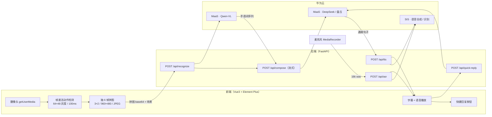

# gloss2speech · 手语通 SignBridge

> **AI 实时手语翻译**：摄像头捕捉手语动作 → 视觉大模型识别手语词 → 大模型整理成通顺中文 → 语音合成播报；
> 反向：健听人说话 → 语音识别成字幕 → 自动生成快捷回复。
>
> 本仓库**按《工程实现方案》实现**：前端采集与抽帧拼图、后端 Qwen-VL / DeepSeek / SIS 编排、Vue3 + FastAPI 工程化落地、Docker 部署。

[](https://www.python.org/)
[](https://fastapi.tiangolo.com/)
[](https://vuejs.org/)
[](https://element-plus.org/)
[](LICENSE)

---

## 系统流程



---

## 功能

- 🎥 **摄像头采集**：浏览器 getUserMedia，1280×720@30fps。
- 🖐 **动作自动切分**：64×48 灰度帧差法 + 状态机（连续 3 帧启动 / 连续 5 帧结束），阈值 T_start / T_stop 页面滑块可调；保留空格键手动录制保底。
- 🧩 **6 帧时序拼图**：均匀抽帧拼成 3×2、960×480、带 1–6 序号，JPEG 0.8、约 50–100KB。
- 👁 **手语识别**：Qwen-VL（MaaS，OpenAI 兼容接口），场景限定词表 + 动作描述提示词，temperature=0.1、15s 超时、JSON 解析失败重试 1 次。
- 🗣 **流式造句**：DeepSeek 把手语词序列整理成通顺口语，SSE 流式返回，前端边收边显示；自动生成备选句。
- 🔊 **语音合成**：SIS TTS 返回 base64 wav（16k），前端直接播放。
- 🔁 **反向沟通**：MediaRecorder 录音 → 转 16k 单声道 wav → SIS 一句话识别 → 字幕 + DeepSeek 生成 3 个快捷回复。
- 🧪 **无密钥可跑**：所有云服务都有 Mock 回退（MOCK_MODE=auto），没有华为云密钥也能把全链路跑通、做 UI 联调。
- 🐳 **Docker 部署**：`Dockerfile` + `deploy/docker-compose.yml` + Nginx 配置。
- 🛡 **公网防护**：`API_TOKEN` 访问口令 + 后端/Nginx 双层限流（`backend/guard.py`），防止云额度被刷爆；浏览器首次访问自动弹窗输口令。
- 💾 **对话持久化**：对话记录存 localStorage（刷新不丢，上限 200 条），支持一键导出 txt；「大字模式」+ 移动端适配，面对面共看一台设备更清楚。
- 📈 **云端探测**：`scripts/probe_cloud.py --all` 一键实测 LLM/VL/TTS/ASR 四路真实延迟（P50/P95/P99）并生成 `reports/cloud_probe.md`。

---

## 目录结构

```text
backend/                     后端（FastAPI）
  main.py                    6 个接口 + CORS
  config.py                  .env 配置（MaaS / SIS / Mock 模式）
  prompts.py                 视觉识别、造句、快捷回复提示词
  services/
    vision.py                Qwen-VL 识别（JSON 解析 + 重试）
    llm.py                   DeepSeek 造句（SSE 流式）/ 快捷回复
    sis.py                   SIS 语音合成 / 一句话识别
  data/scenes.json           场景 + 词表 + 标准动作描述
  tests/test_api.py          接口测试（Mock 模式，8 项）
frontend/                    前端（Vue3 + Vite + Element Plus）
  src/views/Translate.vue    主页面（摄像头 + 词序列 + 翻译 + 反向沟通）
  src/utils/motion.js        帧差法 + 状态机
  src/utils/grid.js          6 帧拼图
  src/utils/recorder.js      录音 -> 16k wav
  src/api.js                 6 个接口封装（含 SSE）
  vite.config.js             dev 代理 /api -> 127.0.0.1:8000
deploy/                      部署（docker-compose / nginx / 说明）
docs/                        方案与审计文档
research/                    前期端侧快路径原型（历史保留，非主实现）
```

---

## 快速开始

### 1. 后端

```bash
python -m pip install -r requirements.txt
cp .env.example .env        # 没密钥可留空，走 Mock
uvicorn backend.main:app --host 127.0.0.1 --port 8000
```

- 接口文档：http://127.0.0.1:8000/docs
- 健康检查：http://127.0.0.1:8000/api/health （会显示当前各服务是 mock 还是真实）

### 2. 前端

```bash
cd frontend
npm install
npm run dev                 # http://127.0.0.1:5173
```

浏览器打开 http://127.0.0.1:5173 ，允许摄像头即可（localhost 属于安全上下文）。

### 3. 不用摄像头验证接口

```bash
curl -s http://127.0.0.1:8000/api/scenes | head -c 300
curl -s -X POST http://127.0.0.1:8000/api/recognize \
  -H "Content-Type: application/json" \
  -d "{\"image\":\"ZmFrZQ==\",\"scene_id\":\"hospital\"}"
curl -s -N -X POST http://127.0.0.1:8000/api/compose \
  -H "Content-Type: application/json" \
  -d "{\"words\":[\"我\",\"头疼\",\"两天\"],\"scene_id\":\"hospital\"}"
```

---

## 配置（.env）

| 变量 | 说明 |
|---|---|
| MAAS_BASE_URL / MAAS_API_KEY | 华为云 MaaS 地址与 API Key（OpenAI 兼容） |
| MAAS_VL_MODEL | 视觉模型名，如 qwen2.5-vl-72b |
| MAAS_LLM_MODEL | 文本模型名，如 deepseek-v3 |
| HW_AK / HW_SK / HW_PROJECT_ID | 华为云 SIS AK/SK 与项目 ID |
| SIS_REGION | SIS 区域，默认 cn-north-4 |
| MOCK_MODE | auto（默认，无密钥自动 Mock）/ 1 强制 Mock / 0 强制真实 |
| VISION_TIMEOUT | 视觉模型超时秒数，默认 15 |

---

## 接口

| 方法 | 路径 | 请求 | 响应 |
|---|---|---|---|
| GET | /api/scenes | — | 场景 + 词表 + 动作描述 |
| POST | /api/recognize | {image: base64, scene_id} | {words, confidence, alternatives} |
| POST | /api/compose | {words, scene_id, history} | SSE：{type: delta/done, ...} |
| POST | /api/tts | {text} | {audio: base64, format: wav} |
| POST | /api/asr | {audio: base64} | {text} |
| POST | /api/quick-reply | {text, scene_id} | {replies: []} |

---

## 与原《工程实现方案》的对应

| 原方案步骤 | 状态 |
|---|---|
| 1. 开通 MaaS / SIS 拿密钥 | ⏳ 需要你提供密钥后填入 .env |
| 2. FastAPI + /tts + /compose | ✅ |
| 3. /recognize 拼图测 10 词 | ✅ 接口与提示词已实现；真实准确率待密钥后实测 |
| 4. 前端摄像头 + 按钮录制 + 拼图上传 | ✅ |
| 5. 手语 → 句子 → 语音 完整链路 | ✅（Mock 模式已端到端验证） |
| 6. 帧差法自动检测替代按钮 | ✅（含阈值滑块 + 空格手动保底） |
| 7. 反向 ASR + 快捷回复 | ✅（Mock 模式已验证） |
| 8. 场景词表 / MetaStudio 数字人 | ✅ 4 个场景 85 词；⏳ 数字人未做（原方案标"可选"） |
| 9. Docker 打包 + ECS 部署 | ✅ 配置文件已提供；⏳ ECS 实例与域名需要你开通 |

> 关于 0.5s：原方案 `9 自述"识别 1–3 秒/词"。本实现严格按原方案（每词一次 Qwen-VL），
> 因此端到端延迟取决于云端模型速度；真实延迟需配置密钥后用浏览器 Network 面板或后端日志实测。

---

## 测试

```bash
# 后端接口（Mock 模式，无需密钥）
python -m pytest backend/tests -q          # 8 passed

# 前端构建
cd frontend && npm run build

# 浏览器冒烟（需要 playwright + chromium；会打开假摄像头走完整链路）
python scripts/vue_smoke_check.py
```

冒烟测试覆盖：页面加载、摄像头 1280×720、手动录制 → Mock 识别出词、流式造句、TTS 播放、
假麦克风 → ASR 文本 → 快捷回复 3 条，且 JS 零报错。

---

## 部署

见 [deploy/README.md](deploy/README.md)：Dockerfile + docker-compose + Nginx 反代 + HTTPS/WSS 说明。

---

## 已知限制

1. **真实云服务尚未联调**：当前仓库处于 Mock 模式验证阶段；`backend/services/vision.py` 与 `backend/services/sis.py` 中的真实 SDK 调用
   需要配置密钥后验证（尤其是 SIS SDK 的参数与返回解析）。
2. **SIS SDK 未安装时自动 Mock**：生产环境请 `pip install huaweicloudsdkcore huaweicloudsdksis`。
3. **延迟**：按原方案每词一次视觉模型调用，预计 1–3 秒/词；与"0.5s"目标存在方案层面的冲突，
   需在按下原方案交付后，用真实密钥实测再做取舍。
4. **通用视觉大模型的手语识别准确率**依赖词表与动作描述质量；4 个场景 85 词的动作描述需对照
   《国家通用手语词典》校订。
5. 浏览器摄像头/麦克风需要 HTTPS 或 localhost。

---

## 文档

| 文档 | 说明 |
|---|---|
| [工程实现方案](工程实现方案.md) | 本实现的依据（施工图） |
| [实现对照表](docs/工程实现方案-实现对照表.md) | 逐条审计（历史记录） |
| [架构方案（归档）](docs/智能体体系与实时翻译架构.md) | 前期端侧快路径设计，对应的原型归档在 research/ |
| [部署说明](deploy/README.md) | Docker / ECS / HTTPS |

---

## License

[Apache-2.0](LICENSE) © 2026 xiaoxianasd
