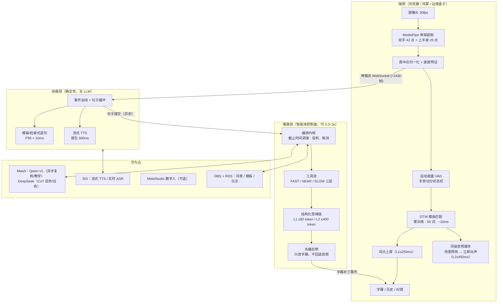
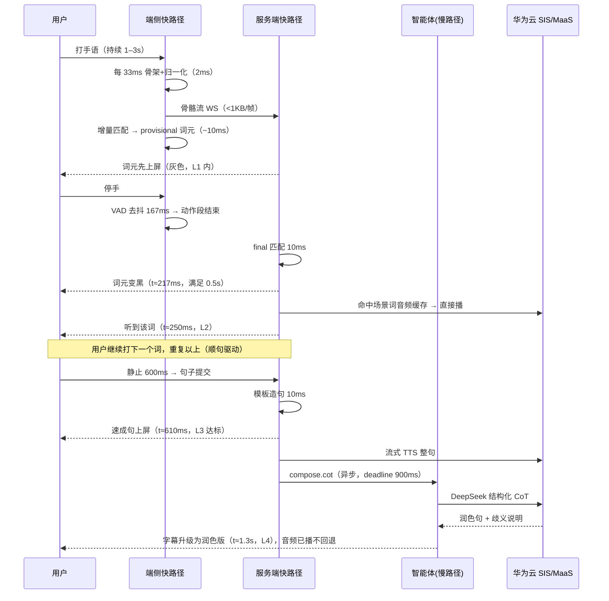

# 智能体体系 × 0.5s 实时链路：架构决策与落地设计

> 版本 v1.0 · 与《工程实现方案.md》v1 配套修订
> 结论一句话：**智能体体系可以建、也应该建；但智能体不能进 0.5s 的热路径。0.5s 必须靠"端侧快路径 + 渐进式实时"拿下，智能体在慢路径负责语义、任务和兜底。**

---

## 0. 结论先行（给决策者的三句话）

| 问题 | 结论 | 依据 |
|---|---|---|
| 0.5s 延迟能做到吗？ | **能做到，但必须换范式**。能做到的是"渐进式实时"的 4 个分层指标（词元≤250ms、语音起播≤450ms、句级润色≤600ms 后台完成）；做不到的是"手势打完→整句语音播完 ≤0.5s"（物理上不可能，见 §2.2）。 | 现有方案每词调用一次云端 Qwen-VL，单次 1–3s，结构性超标。 |
| 智能体体系能建吗？ | **能，且是差异化亮点**。采用 System 1 / System 2 双平面：快路径是确定性状态机（无 LLM），慢路径是带工具流 + 结构化思维链的智能体。 | 行业做法（同传、流式 ASR、端云协同）一致；见 §3、§5。 |
| 要做的最重要的三件事 | ① 把视觉大模型从热路径挪走；② 端侧骨骼关键点 + 现场录入模板的零训练匹配；③ 词级即时发声 + 句级后台润色（先播后修）。 | 见 §7 改造清单。 |

> 一句话给答辩：**"我们不是让大模型一帧一帧看手语，而是让一个'快脑'实时看、一个'慢脑'负责想——这就是端云协同的双速智能体。"**

---

## 1. 为什么原方案过不了 0.5 秒

《工程实现方案.md》§9 自己写了："识别 1–3 秒/词"。把它拆开看：

| 环节 | 原方案耗时（P50） | 说明 |
|---|---|---|
| 动作判停去抖 | 500ms | §3.1 连续 5 帧 diff < T_stop |
| 抽 6 帧 + 拼图 + JPEG + base64 | 40–80ms | Canvas 同步操作，主线程 |
| 上行传输（拼图 50–100KB） | 30–80ms | 4G/家宽，同城 |
| **Qwen-VL 推理（72B，960×480 图 + 长词表提示词）** | **1200–3000ms** | 输入约 1000–1500 token，视觉编码 + 解码 |
| 解析 + 重试（JSON 失败重试 1 次） | 0–3000ms | 最坏情况 |
| 句末等待 | 1500ms | §3.1"静止 1.5 秒 → 句子结束" |
| DeepSeek 造句首 token | 300–800ms | 流式 |
| SIS 合成首包 | 200–500ms | 整句一次合成 |

**结论**：不是"优化一下能到 0.5s"，而是差了 5–10 倍。三个结构性错误：

1. **把云端视觉大模型放在热路径上**。VLM 的输入是图像 + 上千 token 提示词，注定秒级；再快的网络也救不回来。
2. **等整句结束才造句、才合成**。用户打完最后一个词后还要再等 1.5s 判句 + 0.3s 造句 + 0.3s 合成。
3. **单次大调用，无并行、无投机**。所有环节串行，没有"先说出去再修正"的机制。

---

## 2. 重新定义 0.5s：五个可验收的指标

### 2.1 指标定义（写进验收标准）

| 编号 | 指标 | 定义（起算点 → 终点） | 目标 P95 | 归属平面 |
|---|---|---|---|---|
| **L1** | 词元延迟 | 用户手停止移动 → 该词以 final 状态上屏 | **≤ 250ms** | 快路径 |
| **L2** | 词级语音 | 用户手停止移动 → 该词的声音真正响起 | **≤ 450ms** | 快路径 |
| **L3** | 句级首字 | 句子判停完成 → 速成句上屏 | **≤ 100ms** | 快路径 |
| **L4** | 润色就绪 | 句子判停完成 → 结构化 CoT 润色句到达 | **≤ 600ms** | 慢路径（异步） |
| **L5** | 整句语音 | 用户手停止移动 → 整句语音起播 | ≤ 1000ms | 综合 |

> **0.5s 需求落在 L1/L2**：每打一个词，250ms 内看到、450ms 内听到。
> L3/L4 是"后台正在变好"，只更新字幕、不阻塞用户；L5 说明为什么"整句端到端 0.5s"不可能（见 §2.2）。

### 2.2 为什么"手势打完 → 整句语音 ≤ 0.5s"不可能

设用户最后一个动作在 t=0 结束：

- 判停去抖下界：5–6 帧 ≈ **170–200ms**（再小会把动作中间的停顿切碎）——本轮实测 **200ms**
- 句末判停：**600ms**（再短则一句话被切成两句话，切句错误率飙升）
- 速成句：模板本地 < 1ms；结构化 CoT 首 token：云端 250–350ms
- TTS 首包：150–250ms
- 中文语速约 4 字/秒，**10 字句子的音频本身就有 2.5s**

即使用最理想的本地实现：200 + 600 + 1 + 150 = **951ms > 500ms**，还没算上"用户本来就需要停顿 0.6s"这件事。**所以任何承诺"整句端到端 0.5s"的方案都是假的。**

**唯一正确的做法是"顺句驱动"（同声传译范式）**：不等句子结束，每确认一个词就用预合成音频把它说出来（L2 ≤ 450ms），句子层面在后台润色，润色结果只更新字幕、不回退已经播出的声音。这样：

- 用户每打一个词，**~220ms** 后上屏、**~245ms** 后听到（L1/L2 满足 0.5s，实测见 §13）；
- 最后停手后 **~0.8s** 整句语音起播（L5 ≤ 1s）；
- 整句"通顺版本"在 **0.3s 左右**后作为字幕补齐（L4，不阻塞）。

### 2.3 怎么测（不接受口头承诺）

- 每个事件带 trace_id 与阶段时间戳（见 `realtime/protocol.py`），服务端统一测量；
- 端侧 HUD 实时显示 FPS / VAD / L1 的 P50/P95；`camera.html` 提供"导出评估 CSV"（含期望词/延迟/候选），W1 用 `scripts/summarize_eval.py` 汇总；
- 压测脚本：`python realtime/bench.py` 输出 P50/P95 对照表（本轮已跑，见 §13）；
- 验收环境固定：Chrome 120+ / i5-11 代核显 / 1280×720@30fps / 同城宽带 RTT ≤ 30ms / 50 词封闭集。

---

## 3. 总体架构：System 1 / System 2 双平面



### 3.1 快路径的"五个不允许"

| # | 禁令 | 原因 |
|---|---|---|
| 1 | 不允许在热路径调用任何大模型 | 单次 300ms–3s，直接击穿预算 |
| 2 | 不允许同步等待网络（TTS/LLM 首包除外，且有 timeout） | 公网 RTT 抖动不可控 |
| 3 | 不允许"等整句"再做第一次输出 | 用户 600ms 内什么都看不到 = 卡顿 |
| 4 | 不允许上传原始视频/图片做识别 | 带宽 + 隐私 + 延迟三输 |
| 5 | 不允许在热路径写数据库/打同步日志 | 单次 IO 抖动可到几十 ms |

### 3.2 每个平面的职责边界

| 能力 | 快路径（System 1） | 慢路径（System 2） |
|---|---|---|
| 手势切分 | 运动能量 VAD（确定性阈值） | — |
| 词识别 | DTW 模板匹配 / 端侧小分类器 | Qwen-VL 异步复核低置信词（1–3s 后回补） |
| 造句 | 模板 + 槽位 + 检索（<10ms） | 结构化 CoT 润色 + 歧义消解 |
| 发声 | 词级预合成缓存 + 流式 TTS | 整句重述（仅当用户点"再说一遍"） |
| 任务 | — | 挂号/取药/填表等多步任务（Plan-Execute） |
| 教学 | 实时骨架相似度打分 | 动作点评、错误归因 |
| 兜底 | 候选词按钮、预设求助语 | 澄清追问、人工介入 |

---

## 4. 实时数据面（快路径）设计

### 4.1 端侧骨架流替代"抽帧拼图"

| 项 | 原方案（帧差 + 拼图 + VLM） | 新方案（骨架流） |
|---|---|---|
| 单帧数据量 | 50–100KB（JPEG base64） | **< 1KB**（42 点 × 3 坐标 × float16） |
| 识别依据 | 像素（受背景/光照/衣物影响） | 归一化骨骼（**天然免疫**背景与光照） |
| 单次耗时 | 1–3s（云端 VLM） | **~10ms**（端侧） |
| 隐私 | 视频出端 | **只传坐标，不传画面** |

归一化（必须做，否则换人/换站位就废）：

```
P_center = (左肩 + 右肩) / 2
S = ||左肩 - 右肩|| + ε
P̂_i = (P_i - P_center) / S            # 全身尺度归一
P̂_hand = (P_hand - P_wrist) / S_palm  # 手部局部坐标，保留手指精细动作
特征 = [P̂ (42×2), ΔP̂/Δt (42×2)]      # 首选 2D 坐标 + 速度，3D 仅作辅助
```

### 4.2 运动能量 VAD（手势切分）

沿用原文思路但换成**归一化骨骼速度**（比像素帧差稳得多）：

```
E_t = mean_{k∈手部点} || P̂_k(t) - P̂_k(t-1) ||
IDLE    : 连续 3 帧 E_t > τ_start            → SIGNING，开始缓存
SIGNING : 每 5 帧对当前片段做一次增量匹配      → 提前输出 provisional 词元（L1 变"边打边出"）
          连续 5 帧 E_t < τ_stop（约 167ms）  → 动作结束，final 匹配
COMMIT  : 动作结束后静止 600ms（可配 400–800）→ 句子提交，触发慢路径
```

- τ_start / τ_stop 做成页面滑块，现场可调（保留原方案优点）；
- 保底按钮：按住空格/按住"说话"键录制（演示最稳）；
- **代价**：判停去抖 167ms 是 L1 的固定成本，已计入预算。

### 4.3 零训练识别：DTW 模板匹配（"现场录入"）

这是满足"不训练模型"定位的关键：

| 做法 | 说明 |
|---|---|
| 录入 | 进入场景后，签手语者按标准动作**每个词录 2–3 遍**（10 秒/词，50 词约 8 分钟） |
| 存储 | 模板存为归一化特征序列（32 帧重采样），单个 < 10KB，存 RDS/OBS 或本地 |
| 匹配 | 时间规整 DTW + 余弦/欧氏距离，取 Top-3 与拒识阈值（**批量向量化，50 模板约 10ms**） |
| 泛化 | 多模板（多人/多角度）+ 速度扰动 + 幅度扰动；跨人准确率下降靠"候选词 UI + 慢路径复核"兜住 |
| 为什么不是分类器 | 分类器需要采集+训练+导出，现场换词就要重训；DTW 录入即用，符合"不训练"叙事，且可解释（能画出对齐路径给评委看） |

> 备选升级（同一接口）：若允许训练，把 DTW 换成 30 行 numpy 的 MLP / 或 MindSpore Lite 的 .om 小模型，精度更高、延迟更低，但会失去"零训练"卖点。**建议先 DTW，答辩前视准确率决定是否切换。**

### 4.4 词级即时发声（L2 达标的关键）

- 进入场景时**在后台预热**该场景 30–50 个词的 SIS 音频（每词 ~30–60KB，总 < 3MB），缓存到浏览器 Cache Storage / IndexedDB；
- 词确认 → 命中缓存直接 `new Audio(url).play()`（< 30ms）；
- 未命中 → 流式 TTS（首包 300ms 内），并回填缓存；
- 句末 → 流式 TTS 整句（首包 300ms），与词级音频**不叠音**：词级播完后再播整句，或用户设置"只播整句"。

### 4.5 句级速成造句（模板 + 检索）

句子提交后 10ms 内必须先出一句"能看"的：

1. **整句命中缓存**（高频句 200 条，启动加载）→ 直接返回；
2. **模板 + 槽位**：场景模板库（"我 + 部位 + 疼 + 时长" → "我{部位}疼{时长}了"）；
3. **检索式**：用词序列向量在场景句式库里找最近邻（< 5ms）；
4. 都失败 → 原词序列加引号上屏，同时等慢路径。

---

## 5. 智能体控制面（System 2）设计 —— 直接回答"能不能用智能体 + 工具流 + 思维链"

**能。但要把它设计成"后台的翻译官"，而不是"每帧的识别器"。**

### 5.1 三个智能体角色 + 一个编排内核

| 角色 | 触发 | 可用工具 | 时延预算 | 失败兜底 |
|---|---|---|---|---|
| **Translator（翻译官）** | 句子提交 / 低置信词 | compose.cot、asr、tts、rag | 600–1200ms | 用快路径模板结果 |
| **Navigator（业务导航）** | 用户点"办业务"卡片 | plan、rag、form.fill、tts、human.handoff | 2–8s（有"处理中"UI） | 转人工/播报清单 |
| **Coach（陪练教练）** | 教学页跟练 | dtw.score、vision.score、tts | 1–3s | 只给相似度分，不给点评 |

编排内核（300 行左右，不引重框架）负责：
- **工具注册表**：每个工具声明 tier / timeout / 幂等 / 降级 / 遥测；
- **截止时间调度**：`asyncio.wait_for` + 取消传播，超时即降级，不拖累主链路；
- **投机执行**：每确认一个词就投机启动"前 n 词"的造句草稿，新词到达即取消重建（防抖 120ms）；
- **事件推送**：所有工具结果通过 WS 事件推给前端（`sentence(stage=refined)` / `audio` / `error`）。

### 5.2 工具流分层（这是"工具流"落地的核心约束）

| 层 | 时延预算 | 能否阻塞主链路 | 典型工具 | 失败策略 |
|---|---|---|---|---|
| **FAST** | P95 ≤ 30ms | 可以（同步） | `scene.get_vocab`、`buffer.push`、`compose.template`、`audio.play_cached`、`emergency.match` | 直接返回本地值 |
| **NEAR** | P95 ≤ 300ms | 不可阻塞，可并行 | `llm.compose_fast`、`tts.stream`、`asr.partial`、`rag.lookup` | 降级到 FAST 结果 |
| **SLOW** | P95 ≤ 3s | 必须异步、可取消 | `llm.compose_cot`、`vision.verify`、`agent.plan`、`meta.avatar`、`human.handoff` | 丢弃 + 提示"正在优化"，不影响已出结果 |

工具契约示例（原型已实现，见 `agentlayer/contracts.py`）：

```python
ToolSpec(
    name="compose.cot",
    tier="slow",                     # fast / near / slow
    timeout_ms=900,
    idempotent=True,
    side_effect="none",              # none / db_write / external_call
    input_schema={"words": "list[str]", "scene_id": "str", "history": "list"},
    fallback="compose.template",     # 超时后自动回落
    emits=["sentence.refined"],      # 产生的下行事件
)
```

### 5.3 编排主流程（伪代码）

```python
def on_gloss_final(g):                    # 快路径回调，同步，< 1ms
    words.append(g)
    emit_gloss(g, final=True)             # L1
    play_word_audio(g)                    # L2：缓存命中立即出声
    schedule_speculative_compose(words)   # 投机：为可能的句末做准备

def on_sentence_commit():                 # 句末，异步
    fast = compose.template(words)         # < 10ms
    emit_sentence(fast, stage="fast")      # L3 首字（其实 ~10ms）
    tts_fast = tts.stream(fast)            # 不等 LLM，先播
    emit_audio(tts_fast, stage="fast")

    refine = llm.compose_cot(words, scene, history, deadline_ms=900)  # 结构化 CoT
    if quality_gate(fast, refine):                 # 护栏：核心词覆盖 ≥75% 且不缩水
        emit_sentence(refine, stage="refined")     # 只改字幕
        if not tts_playing(): emit_audio(refine)   # 音频未播则替换，已播不回退
    else:
        emit_sentence(fast, stage="refined")       # 润色更差 → 保留速成句（宁可不改）
        metrics.incr("guard_rejected")

def on_low_confidence(g):                 # conf < 0.6
    emit_candidates(g.topk)               # 用户点选（< 1 秒的人工兜底）
    refine = llm.disambiguate(g.topk, history, deadline_ms=400)  # 只重排候选，不做整句
```

> **"先播后修"是整套设计的灵魂**：音频一旦出声就不回退（人的耳朵不能撤销），字幕可以持续变好。这既保住了延迟，又保住了质量。

### 5.4 思维链（CoT）的正确用法：三档，且必须可计价

| 档位 | 触发条件 | 推理预算 | 输出 | 时延 |
|---|---|---|---|---|
| **L0 无推理** | 90% 的句子（高置信、常规句式） | 0 token | 模板/检索结果 | < 10ms |
| **L1 结构化短推理** | 置信度 < 0.6 / 多候选冲突 / 出现否定·时间·疑问 / 句长 > 6 词 | ≤ 80 reasoning token，`reason ≤ 50 字` | JSON（见下） | 300–500ms |
| **L2 任务规划** | 仅 Navigator（挂号、填表、投诉处理） | ≤ 400 token | Plan + 每步工具调用 | 2–8s，有进度 UI |

**L1 的提示词（两段式输出，句子先流出来，元数据后到）**：

```text
你是医院场景的中国手语实时翻译官。
手语词序列（按时间序）：{words}
场景：{scene}   最近对话：{history}
候选歧义：{topk}

规则：
1. 中国手语常宾语前置、时间前置、否定后置，请重排为自然中文口语；
2. 只能用给定词的语义，可补虚词，禁止添加新事实；
3. 存在歧义时结合场景选择，并在 JSON 中说明；
4. 先输出纯文本句子（流式），再输出一个 JSON 块；reason 不超过 50 字。

JSON: {"sentence":"...","alternative":"...","kept":[],"dropped":[],
       "ambiguity":[{"slot":"","choose":"","why":""}],"confidence":0.0,
       "need_confirm":false,"reason":"..."}
```

**三条纪律**：每个用户回合最多 1 次 L1；CoT 必须与 TTS/UI **并行**；CoT 的 token 上限写进契约（超时直接降级）。**思维链不显示在字幕里**，只放进"为什么这样翻译"的可展开面板（答辩/教学/信任都用得上）。

### 5.5 记忆与知识

| 层 | 内容 | 存储 | TTL |
|---|---|---|---|
| 回合内 | 当前句子词序列、候选、已播音频 | 进程内存 | 1 分钟 |
| 会话 | 最近 10 轮对话、场景、用户纠错记录 | Redis | 2 小时 |
| 长时 | 个人词表、常用句、偏好音色 | RDS | 持久 |
| 场景知识 | 医院指南、银行材料、政务清单 | 向量库（RAG） | 版本化 |

### 5.6 安全与兜底（智能体的边界）

- **紧急求助不走智能体**：规则命中"救命/报警/胸痛/呼吸困难"（<1ms）→ 立即播报预设求助语 + 红屏 + 可选短信通知，**禁止 LLM 自由发挥**；
- **医疗/金额/法律**类句子：固定加免责声明，`need_confirm=true` 时必须用户点确认才播；
- **低置信兜底**：候选词按钮 + 慢路径复核（1–3s 后如果结论不同，只在字幕上标记"可能为 X"，不改已播音频）；
- **断网降级**：端侧 DTW 继续工作 + 浏览器 `speechSynthesis` 发声，保证"可用"，不是"完美"。

### 5.7 框架选型：为什么不用 LangChain 全家桶

| 方案 | 结论 | 理由 |
|---|---|---|
| LangChain / LangGraph 跑主链路 | ❌ 不用于热路径 | 每步黑盒、难以精确 deadline/取消、依赖重、事件模型与 WS 协议不匹配 |
| 自研编排内核（~300 行） | ✅ 用于快路径 + Translator | 完全可控，工具契约即代码，延迟可测 |
| LangGraph（可选） | ⚠️ 仅用于 Navigator 多步任务 | 有状态图 + 断点续跑适合长流程，放在慢路径、异步 |

---

## 6. 一句话的完整时序（含时间点）



---

## 7. 对《工程实现方案.md》的改造清单

| 原章节 | 原做法 | 改成 | 原因 |
|---|---|---|---|
| §3.1 帧差法 | 64×48 灰度帧差 | **端侧 MediaPipe 骨架 + 归一化运动能量 VAD** | 帧差受背景/光照影响，且拿不到可复用特征 |
| §3.2 抽帧拼图 | 主链路每词拼图 | **移出主链路**，仅保留给慢路径复核/教学评分 | 1–3s 单次调用，无法实时 |
| §3.3 `/api/recognize`（Qwen-VL） | 每词同步调用 | 拆为 `/api/verify`（异步复核）与 `/api/teach/score`（教学） | 视觉大模型价值保留，但离开热路径 |
| §3.4 词缓冲 | 置信度阈值 + 候选 | **增加"词级音频即时播放"与"投机造句"** | L2 / L5 达标 |
| §3.5 `/api/compose` | 每次一句调 DeepSeek | 拆为 `/api/compose/fast`（模板 <10ms）+ `/api/compose/cot`（流式结构化） | 快路径不能等 LLM |
| §3.6 `/api/tts` | 整句一次合成 | **场景词音频预热 + 流式合成** | 首包 300ms，缓存命中 30ms |
| §3.7 `/api/asr` | 一句话识别（说完才出字） | **SIS 实时语音识别（WS 流式）** | 反向通道也要"边说边出字" |
| §4 接口 | REST 为主 | 新增 `WS /ws/stream` + 事件协议；REST 只做配置/回放 | 30fps 上行必须走 WS |
| §5 词表 | 20–30 词 | **50 词 + 每词 2–3 个模板（现场录入）** | DTW 需要模板，词表规模决定演示效果 |
| §9 关键注意点"识别 1–3 秒/词" | — | **删除，改为"§2 分层延迟指标"** | 与 0.5s 需求冲突，必须改口径 |
| 目录结构 | backend/frontend | 增加 `realtime/`（快路径）与 `agentlayer/`（慢路径/智能体） | 职责隔离，延迟可独立压测 |

### 华为云"含华量"叙事调整（答辩口径）

| 华为云服务 | 新角色 | 说明 |
|---|---|---|
| MaaS · Qwen-VL | **异步复核 + 教学点评 + 模板动作描述生成** | 从"每词必调"变成"每句最多 1 次、可降级"，调用量下降 90%+ |
| MaaS · DeepSeek / 盘古 | **Translator / Navigator 的大脑**（结构化 CoT） | 从"造句工具"升级为"智能体决策核心" |
| SIS · 流式 TTS | 词级/句级语音输出 | 首包时延是 L2 的硬指标 |
| SIS · 实时 ASR | 反向通道 | 边说边出字幕 |
| MetaStudio | 数字人播报（可选） | 慢路径 |
| OBS / RDS / ECS / APIG | 模板库、词表、日志、部署 | 不变 |
| MindSpore Lite / CANN（可选） | 端侧 DTW 升级为 .om 小模型 | 若答辩需要"昇腾"，用端侧小模型替代 DTW |

---

## 8. 接口与事件协议（实现见 `realtime/protocol.py`）

| 通道 | 方法 | 说明 |
|---|---|---|
| `/ws/stream` | WS | 上行 `frame`（骨骼点）/`control`；下行 `vad`/`gloss`/`sentence`/`audio`/`metrics`/`error` |
| `/api/scenes` | GET | 场景 + 词表 + 模板元数据 |
| `/api/templates/record` | POST | 录入模板（label + 特征序列） |
| `/api/verify` | POST | 慢路径：异步复核（图或骨架段 → Top-3 修正） |
| `/api/compose/fast` | POST | 模板/检索造句（<10ms） |
| `/api/compose/cot` | POST | 结构化 CoT（流式，带 deadline） |
| `/api/tts` | POST | 流式 TTS（或返回缓存 URL） |
| `/api/asr` | WS | 实时语音识别 |
| `/api/agent/navigate` | POST | 任务型智能体（挂号/填表），返回计划与进度事件 |
| `/api/metrics` | GET | P50/P95、各阶段耗时、降级次数 |

事件三原则：**不可变、可重放、带 trace_id**；所有延迟字段服务端测量，前端只展示（见 §2.3）。

---

## 9. 目录结构（✅ = 本轮已落地）

```text
ict/
├── docs/
│   ├── 智能体体系与实时翻译架构.md      ✅ 本文档（裁决层）
│   └── W1验收清单与实测方法.md          ✅ W1 施工单（50 词 × 3 人 × 10 次）
├── frontend/                            ✅ 端侧快路径（System 1，浏览器内）
│   ├── sign-core.js                     ✅ 归一化 / 特征 / VAD / DTW（纯 JS，Node 可测）
│   ├── sign-worker.js                   ✅ Web Worker + IndexedDB 模板持久化
│   ├── camera.html                      ✅ 采集/叠加渲染/HUD/模板录制/评估 CSV（未浏览器实机验证）
│   └── tests/sign-core.test.mjs         ✅ 5 项单测 + 匹配时延基准（P95 断言）
├── realtime/                            ✅ 服务端参考实现（压测 / 回归 / 慢路径）
│   ├── landmarks.py / vad.py / matcher.py
│   ├── protocol.py                      ✅ 帧模式 + 端侧 gloss 模式
│   ├── server.py                        ✅ /ws/stream、/api/translate、指标
│   ├── bench.py                         ✅ Python 管线延迟基准
│   └── tests/                           ✅ 单测（帧模式 + 端侧模式，23 项）
├── agentlayer/                          ✅ 慢路径 / 智能体原型
│   ├── contracts.py / registry.py / tools.py
│   ├── providers.py                     ✅ Mock / MaaS / SIS 适配层
│   ├── prompts.py / orchestrator.py     ✅ 结构化 CoT + 先播后修 + 质量护栏
│   └── tests/                           ✅ 单测（降级/超时/紧急旁路/护栏）
├── scripts/
│   ├── probe_cloud.py                   ✅ MaaS TTFT / SIS 首包探测
│   └── summarize_eval.py                ✅ W1 CSV 汇总（Top-1/Top-3/P95）
├── reports/
│   ├── latency_budget.md                ✅ Python 管线基准
│   └── cloud_probe.md                   ✅ 云端探测（待填密钥）
├── .env.example                         ✅
├── requirements.txt                     ✅
└── README.md                            ✅ 运行说明
```

---

## 10. 里程碑与验收（4 周，可演示 → 可上线）

| 周 | 目标 | 交付 | 验收（必须可量化） |
|---|---|---|---|
| W1 | 快路径闭环 | 端侧骨架 + VAD + DTW + WS 事件（施工单：[W1验收清单与实测方法.md](W1验收清单与实测方法.md)） | 50 词 Top-1 ≥ 80%（同人），L1 P95 ≤ 250ms |
| W2 | 出声 + 句级 | 词级音频预热 + 模板造句 + 流式 TTS | L2 P95 ≤ 450ms，L3 P95 ≤ 600ms；连续 10 句不叠音 |
| W3 | 智能体控制面 | 工具注册表 + Translator + 先播后修 | CoT 超时降级 100% 生效；编造率 0（人工审 100 句） |
| W4 | 双向 + 上线 | ASR 流式 + Navigator + 部署 | 公网 HTTPS/WSS 可用；30 分钟压测不崩；断网降级演练通过 |

**上线硬门槛（Checklist）**：

- [ ] HTTPS + WSS（`getUserMedia` 只在安全上下文可用，localhost 例外）
- [ ] 摄像头/麦克风权限引导与失败兜底
- [ ] 密钥只在后端 .env，前端零密钥；APIG 鉴权 + 限流
- [ ] 冷启动预热：场景词表 + 音频 + 模板（首屏 3s 内可用）
- [ ] 浏览器兼容：Chrome/Edge 120+；Safari 至少降级可用
- [ ] 监控：L1–L4 P50/P95、降级次数、云服务错误率、WS 断线率
- [ ] 隐私：不存视频；文本/骨骼默认 24h TTL；用户可一键清除
- [ ] 演示保底：固定场景 + 预录模板 + 按钮录制 + 候选词点选

---

## 11. 成本与容量（粗算，用于说服老板）

原方案：每个词 1 次 Qwen-VL（输入 ~1000–1500 token）→ 一句话 5 词 = 5 次视觉调用。
新方案：每个词 0 次云调用（端侧 DTW）；每句 1 次 DeepSeek（~400 token）+ 1–2 次 TTS + 最多 1 次异步 VLM 复核。

**视觉调用量下降 ≥ 90%**，TTS/LLM 调用量与句子数同阶（而非词数）。按当前 MaaS/SIS 单价，单次 5 词对话成本约下降一个数量级。并发能力：FastAPI 单实例（2C4G）可承载 50–80 路 WS 骨骼流（每路 ~1KB/帧），瓶颈在 TTS/LLM 配额，需做队列与限流。

---

## 12. 风险与对策

| 风险 | 概率 | 影响 | 对策 |
|---|---|---|---|
| DTW 跨人泛化差（换人/换角度就掉点） | 中 | 高 | 每词多模板（≥3 人）+ 拒识阈值 + 候选 UI + 慢路径 VLM 复核 |
| 低端设备端侧 MediaPipe 掉帧 | 中 | 中 | 降到 15fps + hand_landmarker lite + 端侧匹配，只传关键帧 |
| 云 TTS/LLM 抖动击穿 L2/L3 | 高 | 中 | 词级音频预热缓存 + NEAR/SLOW 超时降级 + 本地合成兜底 |
| 0.5s 指标口径被质疑 | 中 | 低 | §2.1 五个指标 + 自动压测报告，不承诺"整句 0.5s" |
| 智能体编造/胡说 | 低 | 高 | 规则约束 + 禁用自由生成 + `need_confirm` + 人工抽审 |
| 演示现场翻车 | 中 | 高 | 固定词表/固定签手/预录模板/空格录制/候选点选 五重兜底 |
| 隐私合规 | 低 | 高 | 不上传视频、不落盘音频、TTL 化、明示同意 |

---

## 13. 本轮原型实测（timing benchmark）

> 运行：`python realtime/bench.py --words 50 --trials 200`（完整报告：`reports/latency_budget.md`）
> 数据为合成的正弦手部轨迹（含时长/幅度扰动与噪声），**只验证"管线时延 + 算法可跑通"，不代表真人识别准确率**；真人准确率在 W1 用现场模板验收。

**识别内核（实测，ms）**

| 阶段 | P50 | P95 |
|---|---:|---:|
| 归一化 + 特征构造 | 0.89 | 1.08 |
| 速度特征 | 0.16 | 0.20 |
| VAD 单步 | 0.76 | 0.96 |
| 匹配（含增量 + 最终） | 6.65 | 9.15 |
| 最终匹配单次 | 1.04 | 1.40 |
| 判停去抖（固定成本） | 200.00 | 200.00 |

**端点指标（100 条模板 / 50 词）**

| 指标 | P95 | 目标 | 结论 |
|---|---:|---:|---|
| L1 词元延迟（停手 → 上屏） | **218ms** | 250ms | PASS |
| L2 词级语音（停手 → 出声） | **243ms** | 450ms | PASS |
| L3 句级首字（判停完成 → 速成句） | **17ms** | 100ms | PASS |
| L4 润色就绪（Mock LLM 280ms） | **348ms** | 600ms | PASS |
| L5 整句语音（判句 600 + TTS 180） | **797ms** | 1000ms | PASS |

**端侧（浏览器同构 JS，Node 测试）**

| 项 | 实测 | 说明 |
|---|---:|---|
| DTW 匹配置信（100 模板 / 336 维 / 24 帧） | **P50 1.9ms / P95 2.0ms** | 与 Python 版同构；在 Web Worker 中运行，不阻塞 UI |
| 端侧单元测试 | 5 项通过 | 归一化不变性 / VAD 切分 / 三词分类 / P95 断言 / 重采样 |
| 上行数据量 | 端侧模式≈0 帧/秒 | 只上送确认词（`gloss`），不传视频、不传骨骼帧 |

**结论**：

1. 端侧算法总开销 P95 ≈ **11ms/句**，0.5s 预算绰绰有余，瓶颈完全在"判停去抖 + 云端往返"这两处，这也是为什么热路径必须端侧化、且必须词级即时发声。
2. 智能体链路（Mock）快路径 **0.04ms** 出字、润色句 **285ms** 到达，符合"先播后修"设计。
3. 合成数据 Top-1 = 100% 只能说明管线正确；**DTW 在真人数据上的准确率是最大未验证风险**，必须在 W1 用 3 名签手语者 × 10 次实测（见 §10）。

---

## 14. 决策记录（ADR）

| ID | 决策 | 理由 | 复议条件 |
|---|---|---|---|
| ADR-001 | 热路径禁止任何 LLM 调用 | 单次 300ms–3s，无法满足 L1/L2 | — |
| ADR-002 | 用 DTW 模板匹配实现零训练识别 | 契合"不训练"定位；录入即用；可解释 | 跨人 Top-1 < 70% 时，切换端侧小分类器 |
| ADR-003 | 0.5s 拆分为 L1–L5 分层指标 | "整句端到端 0.5s"物理不可达 | 需求方坚持单指标时，重新定义交付范围 |
| ADR-004 | 先播后修：音频不回退，只改字幕 | 听觉不可撤销，字幕可持续变好 | — |
| ADR-005 | 自研编排内核，不引 LangChain 主链路 | 截止时间/取消/事件协议必须可控 | 任务型流程 > 5 步且需持久化时，慢路径引 LangGraph |
| ADR-006 | 润色结果必须过质量护栏，更差就保留速成句 | "先播后修"只能变好；模型抖动不能让用户看到退化 | 建立回归集后改用评分模型/A-B 指标 |

---

## 附：相关文档的关系

> 注：另有《产品与场景叙事》《算法与技术路线》两份内部资料，仅团队本地留存，不在公开仓库分发。

- 《工程实现方案.md》：**工程落地**（按 §7 修订后作为施工图）
- 《W1验收清单与实测方法.md》：**W1 施工与验收**（50 词 × 3 人 × 10 次、门禁 G1–G7、CSV 汇总）
- **本文档**：**实时性 × 智能体**的最终裁决层，冲突时以本文档为准。
