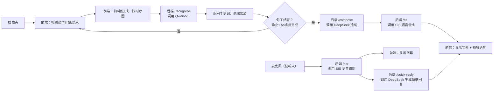

# 手语翻译平台 · 工程实现方案

> ⚠️ **修订提示（v1.1）**：本方案的原热路径（每词一次 Qwen-VL，1–3s/词）无法满足"实时翻译 ≤0.5s"。
> 实时链路与智能体体系已按 [docs/智能体体系与实时翻译架构.md](docs/智能体体系与实时翻译架构.md) §7 重排：
> 视觉大模型移出热路径（改为异步复核/教学），快路径改为"端侧骨骼 + 零训练 DTW + 词级即时发声"，0.5s 指标见该文档 §2.1。
> 本文档仍作为施工图参考，冲突处以上述架构文档为准。

> 原则：**不训练模型**，全部能力调用华为云 API；我们写的是：前端采集、后端编排、提示词。

---

## 1. 总流程



---

## 2. 技术清单

| 环节 | 技术 / 服务 | 用途 |
|---|---|---|
| 摄像头采集 | 浏览器 `navigator.mediaDevices.getUserMedia` | 获取视频流 |
| 动作检测 | Canvas 帧差法（比较相邻帧像素变化） | 判断手语动作的开始和结束，不需要模型 |
| 抽帧拼图 | Canvas `drawImage` + `toDataURL('image/jpeg')` | 把一个动作拼成 3×2 时序图 |
| 手语识别 | **华为云 ModelArts Studio（MaaS）· Qwen-VL** | 看图，从场景词表里选出手语词 |
| 造句 / 快捷回复 | **华为云 MaaS · DeepSeek-V3（或盘古）** | 词序列 → 通顺中文；根据对方的话生成回复选项 |
| 语音合成 | **华为云 SIS · 语音合成** | 句子 → 音频 |
| 语音识别 | **华为云 SIS · 一句话识别**（后期可换成实时语音识别） | 健听人说话 → 文字 |
| 数字人（可选） | 华为云 MetaStudio | 数字人播报 |
| 前端框架 | Vue3 + Vite + Element Plus | 页面 |
| 后端框架 | Python 3.10 + FastAPI + Uvicorn | 接口编排 |
| SDK | `openai`（调 MaaS）、`huaweicloudsdkcore` + `huaweicloudsdksis`（调 SIS） | 调用云服务 |
| 存储 | 本地 JSON 起步 → 华为云 RDS / OBS | 场景词表、对话记录、示范视频 |
| 部署 | Docker + 华为云 ECS | 上线 |

---

## 3. 各模块怎么做

### 3.1 前端：动作检测（帧差法）
1. 每 100ms 从 `<video>` 取一帧，缩成 64×48 的灰度图。
2. 计算和上一帧的平均像素差 `diff`。
3. 状态机：
   - `IDLE`：连续 3 帧 `diff > T_start` → 进入 `SIGNING`，开始缓存帧
   - `SIGNING`：缓存原始帧（每 200ms 存一张，最多 30 张）；连续 5 帧（0.5 秒）`diff < T_stop` → 一个动作结束，送去拼图
   - 动作结束后连续 1.5 秒都静止 → **句子结束**
4. 阈值 `T_start`、`T_stop` 在页面上提供滑块，现场可以调。
5. 保底：提供"开始 / 结束"按钮（或按住空格键录制），演示时最稳。

> 进阶（可选）：用 MediaPipe `HandLandmarker`（现成模型，JS 直接调用）判断画面里有没有手，比帧差法更准。

### 3.2 前端：抽帧拼图
- 从缓存的 N 帧里**均匀取 6 帧**。
- 每帧缩到 320×240，按 3 列 2 行拼成 960×480 的画布，左上角标上序号 1–6。
- 导出 JPEG（质量 0.8），转成 base64，大约 50–100KB，远低于 10MB 的上限。

### 3.3 后端：手语识别 `/api/recognize`
- 输入：拼图（base64）、场景 ID
- 处理：从 `scenes.json` 取该场景的词表和动作描述 → 拼成提示词 → 调用 Qwen-VL → 解析返回的 JSON
- 参数：`temperature=0.1`；超时 15 秒；JSON 解析失败就重试 1 次
- 输出：`{ words, confidence, alternatives }`

提示词：
```text
你是中国手语翻译专家。图片是一个手语动作的6帧，序号1-6表示时间顺序。
场景：{scene_name}
只能从以下词表中选择（每行：词 - 标准动作）：
{vocab_with_desc}
输出 JSON：{"words":["词"],"confidence":0到1,"alternatives":[["候选词"]]}
无法判断时输出 {"words":[],"confidence":0}。不要输出其他内容。
```

### 3.4 前端：词缓冲
- `confidence >= 0.6`：直接加入当前句子
- `confidence < 0.6`：显示候选按钮，用户点选后再加入
- 每个词都可以点击删除（纠错）

### 3.5 后端：造句 `/api/compose`
- 输入：词序列、场景、最近 5 轮对话
- 调用 DeepSeek，开启 `stream=True`，前端边收边显示
- 提示词：
```text
把手语词序列整理成通顺、礼貌的中文口语。
规则：只用给定词的含义，可补虚词，不添加新信息。
场景：{scene}  对话历史：{history}
词序列：{words}
输出 JSON：{"sentence":"...","alternative":"..."}
```

### 3.6 后端：语音合成 `/api/tts`
- 用 SIS SDK 调用语音合成，输入文本，返回 base64 音频（wav 格式，16k 采样率）
- 前端用 `new Audio('data:audio/wav;base64,...')` 播放

### 3.7 后端：语音识别 `/api/asr` + 快捷回复 `/api/quick-reply`
- 前端：用 `MediaRecorder` 录音（按住说话）→ 转成 16k 单声道 wav → 上传
- 后端：调用 SIS 一句话识别（音频不超过 1 分钟）→ 返回文字
- 拿到文字后，紧接着调用 DeepSeek 生成 3 个快捷回复：
```text
对方说："{text}"。场景：{scene}。为听障用户生成3个可能的简短回复（每个≤10字），输出JSON数组。
```
- 用户点击某个快捷回复 → 直接走 `/api/tts` 播放

---

## 4. 接口定义

| 方法 | 路径 | 请求 | 响应 |
|---|---|---|---|
| GET | `/api/scenes` | — | `[{id, name, vocab:[{word, desc}]}]` |
| POST | `/api/recognize` | `{image: base64, scene_id}` | `{words:[], confidence, alternatives:[[]]}` |
| POST | `/api/compose` | `{words:[], scene_id, history:[]}` | 流式返回 `{sentence, alternative}` |
| POST | `/api/tts` | `{text}` | `{audio: base64, format:"wav"}` |
| POST | `/api/asr` | `{audio: base64}` | `{text}` |
| POST | `/api/quick-reply` | `{text, scene_id}` | `{replies:[]}` |

---

## 5. 数据：`scenes.json`

```json
[
  {
    "id": "hospital",
    "name": "医院就诊",
    "vocab": [
      {"word": "你好", "desc": "一手食指指向对方，然后伸出拇指"},
      {"word": "头疼", "desc": "一手指向头部，五指微屈做抓痛状"},
      {"word": "发烧", "desc": "..."}
    ]
  }
]
```
- 每个场景先做 **20–30 个词**，跑通后再扩充到 50–100 个。
- 动作描述参考《国家通用手语词典》。描述写得越准，识别越准。

---

## 6. 配置 `.env`

```ini
MAAS_BASE_URL=https://api.modelarts-maas.com/v1
MAAS_API_KEY=xxx
MAAS_VL_MODEL=qwen2.5-vl-72b        # 以控制台"预置服务"中的 model 参数为准
MAAS_LLM_MODEL=deepseek-v3          # 同上

HW_AK=xxx
HW_SK=xxx
HW_PROJECT_ID=xxx
SIS_REGION=cn-north-4
```

---

## 7. 目录结构

```
signbridge/
├── backend/
│   ├── main.py              # FastAPI 入口、路由
│   ├── config.py            # 读取 .env
│   ├── services/
│   │   ├── vision.py        # Qwen-VL 识别
│   │   ├── llm.py           # DeepSeek 造句 / 快捷回复
│   │   └── sis.py           # 语音合成 / 识别
│   ├── prompts.py           # 提示词模板
│   ├── data/scenes.json
│   └── requirements.txt     # fastapi uvicorn openai huaweicloudsdksis python-dotenv
├── frontend/
│   └── src/
│       ├── views/Translate.vue   # 主页面
│       ├── utils/motion.js       # 帧差法 + 状态机
│       ├── utils/grid.js         # 抽帧拼图
│       ├── utils/recorder.js     # 录音转 wav
│       └── api.js
└── .env
```

---

## 8. 开发步骤（按顺序，每步都可以验证）

| 步骤 | 做什么 | 验证标准 |
|---|---|---|
| 1 | 开通 MaaS（Qwen-VL、DeepSeek）和 SIS，拿到密钥 | 用 Python 脚本单独调通三个接口 |
| 2 | 后端搭 FastAPI，实现 `/tts`、`/compose` | 用 Postman 输入文字能拿到句子和音频 |
| 3 | 实现 `/recognize`，手动准备几张拼图来测 | 10 个词测下来准确率可以接受；调整提示词和动作描述 |
| 4 | 前端：打开摄像头 + 按钮录制 + 拼图上传 | 点按钮打一个手语，页面上显示出识别的词 |
| 5 | 前端：词缓冲 → 造句 → 播放语音 | 完整的"手语 → 语音"链路跑通 |
| 6 | 前端：帧差法自动检测动作，替代按钮 | 不点按钮也能自动切分动作 |
| 7 | 反向：录音 → `/asr` → 字幕 → 快捷回复 | 对着麦克风说话能显示字幕和 3 个回复按钮 |
| 8 | 补充场景词表；（可选）MetaStudio 数字人 | — |
| 9 | Docker 打包，部署到 ECS | 公网可以访问 |

---

## 9. 关键注意点

- **准确率主要靠词表和动作描述**：词表越小、描述越准越好。先在一个场景里做到稳定，再扩展。
- **调用频率**：一个动作调用一次视觉模型，一句话调用一次文本模型。**不要每帧都调用**。
- **延迟预估**：识别 1–3 秒/词，造句不到 1 秒（流式），合成约 0.5 秒。词级结果先显示出来，体验就不会卡。
- **兜底**：识别失败时允许用户从词表里手动点选，保证演示流程不断。
- **MaaS 区域**：部分视觉模型只在特定区域开通（如西南-贵阳一），模型名写进配置，方便切换。
- **密钥安全**：AK/SK 和 API Key 只放在后端 `.env` 里，前端不能接触。
